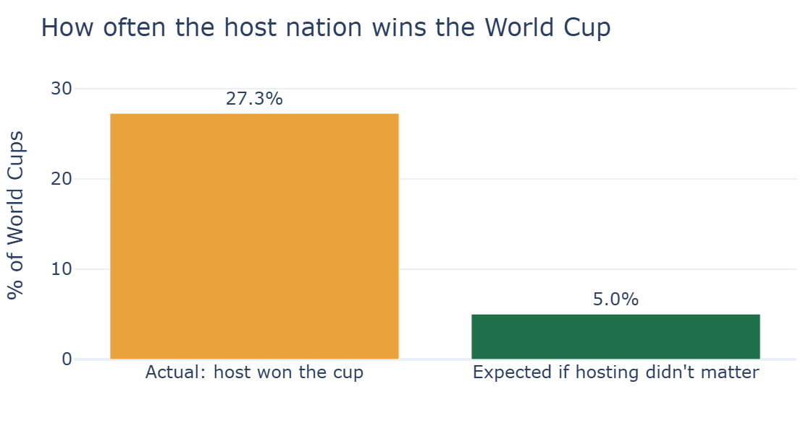
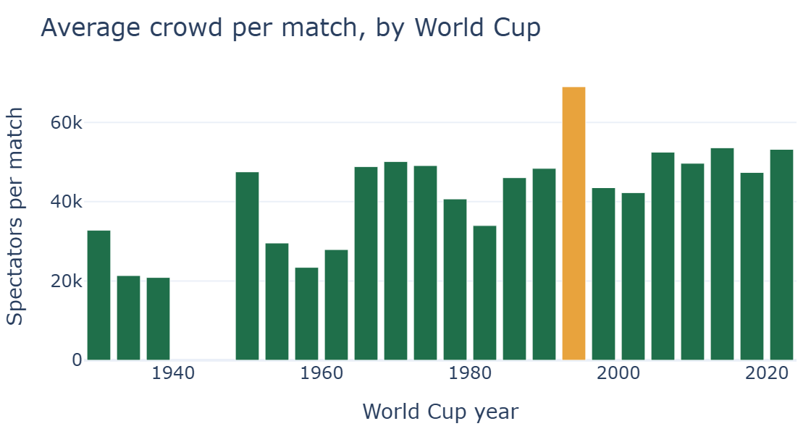
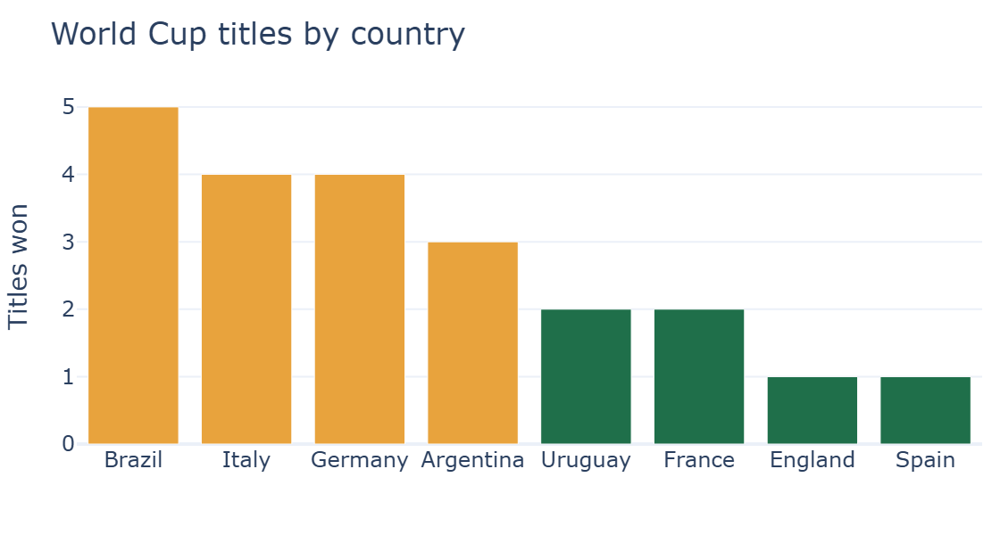

# World Cup Data Cleaning and Analytics

An end-to-end data project on FIFA World Cup history: cleaning five raw datasets, analyzing them in Python, and presenting the results as an executive summary and an interactive dashboard. Built as part of the Tamkeen/IX Coders program.

## Key Findings

<!-- TODO: replace each caption with the one-sentence finding the chart shows. -->


*Finding 1: one-sentence takeaway.*


*Finding 2: one-sentence takeaway.*


*Finding 3: one-sentence takeaway.*

## Deliverables

| File | Description |
|---|---|
| `Cleaning.ipynb` | Loads the raw CSVs, cleans them, and writes the `*_clean.csv` files |
| `Analytics.ipynb` | Exploratory analysis and the charts behind the findings |
| `executive_dashboard.html` | Interactive dashboard (download and open in a browser) |
| `executive_summary.pdf` | Executive summary of the findings |
| `EDAminiProject.pdf` | Project brief |

## Data

| Raw file | Cleaned file | Content |
|---|---|---|
| `wc_all_matches.csv` | `wc_all_matches_clean.csv` | Match-level results across all editions |
| `wc_all_editions.csv` | `wc_all_editions_clean.csv` | Summary data per tournament edition |
| `wc_top_scorers.csv` | `wc_top_scorers_clean.csv` | Top scorers |
| `wc_2026_teams.csv` | `wc_2026_teams_clean.csv` | Teams in the 2026 tournament |
| `wc_2026_fixtures.csv` | `wc_2026_fixtures_clean.csv` | 2026 fixtures |

<!-- TODO: add the data source (for example, the Kaggle dataset name and link) and its license. -->

## Data Cleaning

<!-- TODO: replace with the issues you actually fixed in Cleaning.ipynb. Examples of what to list:
- Missing values and how each was handled
- Duplicate rows removed
- Inconsistent team names standardized
- Column types corrected (dates, integers)
-->

1. Issue found, and the fix applied.
2. Issue found, and the fix applied.
3. Issue found, and the fix applied.

## Tech Stack

- Python (version pinned in `.python-version`)
- Jupyter notebooks
- [uv](https://docs.astral.sh/uv/) for dependency and environment management

<!-- TODO: list the libraries from pyproject.toml that you actually use (for example pandas, matplotlib). -->

## Getting Started

1. Install [uv](https://docs.astral.sh/uv/getting-started/installation/).
2. Clone the repository:

   ```bash
   git clone https://github.com/iMohamed-XD/World_cup_data_cleaning_and_analytics.git
   cd World_cup_data_cleaning_and_analytics
   ```

3. Recreate the environment from `uv.lock`:

   ```bash
   uv sync
   ```

4. Run the notebooks in order, `Cleaning.ipynb` first, then `Analytics.ipynb`. Open them in VS Code, or start Jupyter if it is installed in the project:

   ```bash
   uv run jupyter lab
   ```

## Project Structure

```
.
├── Cleaning.ipynb
├── Analytics.ipynb
├── executive_dashboard.html
├── executive_summary.pdf
├── EDAminiProject.pdf
├── finding1.png / finding2.png / finding3.png
├── wc_*.csv              # raw data
├── wc_*_clean.csv        # cleaned data
├── pyproject.toml
├── uv.lock
└── .python-version
```

## Author

**Mohammad Amin**: Computer Science student and Laravel/Python developer, currently training in ML, DL, and AI solutions at Tamkeen/IX Coders.

GitHub: [@iMohamed-XD](https://github.com/iMohamed-XD)
